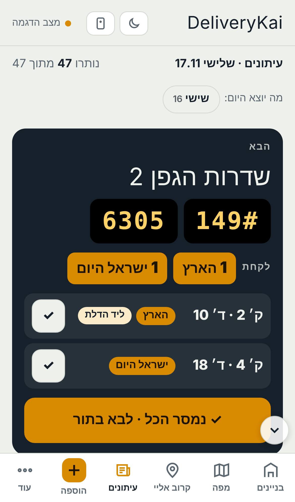
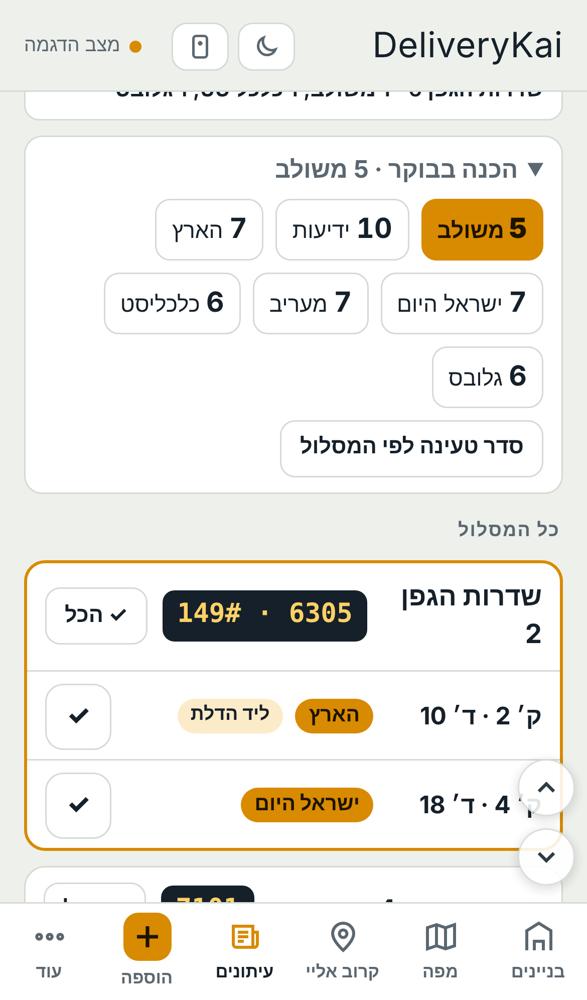
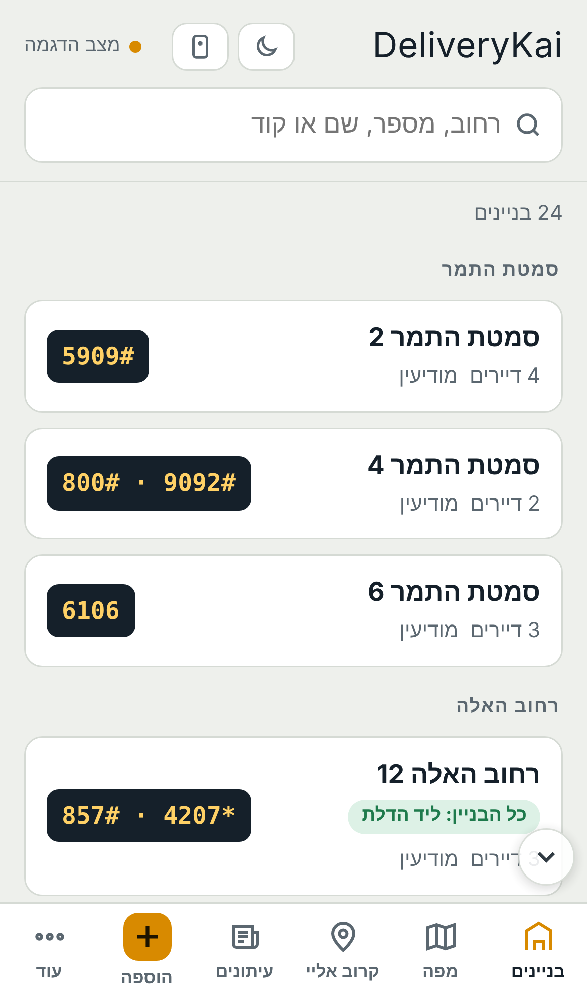
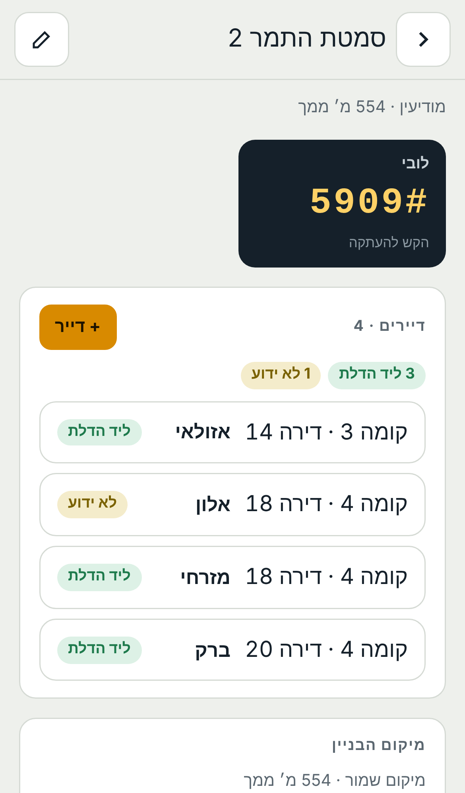

# DeliveryKai

**A route-execution web app for field delivery.** It turns a paper delivery route into a guided, one-stop-at-a-time flow on the phone: address, access code, floor, apartment and what to drop, in high-contrast text you can read in the dark.

I built it for my own work as a newspaper and parcel carrier, and use it every morning.

| Next stop | Morning prep | Code bank | Building card |
|---|---|---|---|
|  |  |  |  |

> All data in this repo and in the screenshots is generated sample data. No real customers, codes or addresses.

## The problem

A newspaper route is 110–140 buildings and 160–180 papers a day, delivered between roughly 4am and 6am. New carriers work from a small-print paper sheet, in the dark, stopping at every building to find the code, floor, apartment and paper type. Learning a route by heart usually takes 4–6 weeks.

The bottleneck isn't walking speed. It's **reading information in bad conditions.**

## The result

| Day | Setup | Route time |
|---|---|---|
| 1 | Two people, paper sheet | 3:00 |
| 2 | Solo, with the app | 2:00 |
| 3 | Solo, with the app | **1:40** |

Experienced carriers average about 2:00 on this route. Ramp-up went from ~6 weeks to ~3 days.

On parcel routes, the building-code bank (~300 codes collected over two years) prevents around 10 failed deliveries a week and removes most "what's the code?" phone calls.

## Features

**Newspaper route mode**
- One stop at a time: address, entrance codes, what to take, and each apartment's paper
- "Delivered, next" button moves through the route in order
- Morning prep: how many of each paper to load, with combined bundles counted automatically
- Day-specific subscribers (Friday-only, weekly magazines) and paused subscriptions
- Paste the full route once, then paste only daily changes (add, remove, pause, move, notes)
- GPS stamp on every delivery, exportable for pace and route analysis

**Code bank (parcels)**
- Searchable list of buildings by street, number, name or code
- Gate and lobby codes, tap to copy
- Residents with floor, apartment and door-drop permission (leave at door / hand only / unknown)
- Per-building and per-resident notes
- Map and "near me" views, plus a drive mode that opens a building's card when you arrive

**App**
- Installable PWA, works offline, syncs when back online
- Hebrew, right-to-left, light and dark themes
- Email login; each user only sees their own data

## Tech

- Vanilla JavaScript, single-page app, no framework or build step
- Supabase (Postgres + Auth) for sync, with an offline outbox in localStorage
- Leaflet + OpenStreetMap for maps and geocoding
- Service worker for offline use
- Built with AI-assisted development (Claude). First version took about 30 minutes; improved daily from real use

## Run the demo

```bash
npx serve .
```

Open the local URL. `config.js` is set to demo mode, so the app runs fully in the browser with generated sample data and no cloud connection.

To connect your own Supabase project, copy `config.example.js` to `config.js`, add your project URL and publishable key, and keep Row Level Security enabled on the `buildings` table.

## Privacy

The real version holds customer names, apartments and building codes, so it stays private. This public repo is a demo build: the cloud connection is removed and all data is generated.
